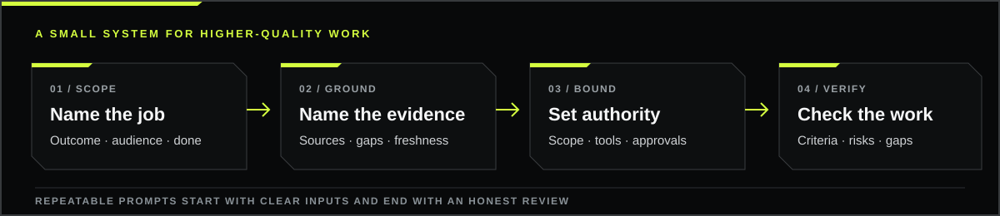

<div align="center">


<p><strong>An independent, practical field guide to enterprise AI workflows.</strong></p>

<p>
<a href="docs/quick-start.md">Quick start</a> &nbsp;·&nbsp;
<a href="docs/prompt-templates.md">Prompt templates</a> &nbsp;·&nbsp;
<a href="docs/evaluation-playbook.md">Evaluation playbook</a> &nbsp;·&nbsp;
<a href="docs/official-resources.md">Official references</a> &nbsp;·&nbsp;
<a href="resources/README.md">Full guide + prompt library</a>
</p>

<p><a href="https://github.com/RawPowered">RAWPOWERED / PROJECT SHOWCASE</a></p>

</div>

---

## Start with a route

| **I need to…** | **Start here** | **You’ll get** |
|---|---|---|
| Frame a one-off task | [Quick start](docs/quick-start.md) | A concise brief for the outcome, evidence, constraints, and checks |
| Build a reusable prompt | [Prompt templates](docs/prompt-templates.md) | Compact and higher-assurance templates with clear approval boundaries |
| Decide whether a workflow is ready | [Evaluation playbook](docs/evaluation-playbook.md) | A repeatable test and release record |
| Verify a product-specific detail | [Official references](docs/official-resources.md) | Primary sources for current model, prompting, evaluation, and privacy information |

## The working path



The guide treats quality as a workflow: define success first, make the permitted evidence clear, set decision and action boundaries, then check the actual result.

## A prompt example

**Vague request**

> Review this vendor.

**A reviewable brief**

```text
Goal: Recommend whether we should run a limited pilot of Vendor A for support-ticket
summarization. Audience: the operations and security leads.

Evidence: Use the vendor security packet, our data-classification policy, and the
pilot requirements below. Separate vendor claims from verified evidence. List gaps.

Boundaries: Do not send data to the vendor or change any system. Flag any action
that would require approval.

Acceptance: Compare data handling, access controls, retention, integration effort,
and exit options. Identify any unmet pilot requirement.

Return: One-page recommendation, evidence table, open questions, and a go/no-go
checklist. State what was not verified.
```

This gives the reviewer a defined decision, evidence trail, action boundary, and usable output. It does not turn model output into vendor assurance; a responsible person still reviews the underlying evidence.

## Resource library

### Frame the work

- [Quick start](docs/quick-start.md); a short path from request to verifiable result.
- [Prompt templates](docs/prompt-templates.md); copy-ready compact and higher-assurance formats.

### Check the work

- [Evaluation playbook](docs/evaluation-playbook.md); representative cases, criteria, repeated trials, failure review, and release decisions.
- [Official references](docs/official-resources.md); primary links for changing product details and current evaluation guidance.

### Download the complete publication

The latest Cybersecurity Revision 2 source package is available as a [complete ZIP download](resources/GPT-5.6_Sol_High_Cybersecurity_Revision_2.zip) and as individual files in [`resources/gpt-5.6-sol-cybersecurity-revision-2/`](resources/gpt-5.6-sol-cybersecurity-revision-2/). It includes the 209-page master guide, the full 80-prompt leadership library, the 24-prompt purple-team pack, operational templates, the supplemental architecture module, evaluation materials, and SHA-256 checksums.

- [209-page Master Guide PDF](resources/gpt-5.6-sol-cybersecurity-revision-2/GPT-5.6_Sol_High_Final_Master_Guide.pdf)
- [Leadership prompt library PDF](resources/gpt-5.6-sol-cybersecurity-revision-2/GPT-5.6_Sol_High_Phase_3_Leadership_Prompt_Library.pdf) · [copy-ready prompt library](resources/gpt-5.6-sol-cybersecurity-revision-2/GPT-5.6_Sol_High_Phase_3_Copy_Ready_Prompt_Library.md)
- [Purple-team prompt pack](resources/gpt-5.6-sol-cybersecurity-revision-2/GPT-5.6_Sol_High_Purple_Team_Copy_Ready_Prompt_Pack.md) · [operational templates](resources/gpt-5.6-sol-cybersecurity-revision-2/GPT-5.6_Sol_High_Purple_Team_Operational_Templates.md)
- [Package index and revision notes](resources/README.md)

## What this is, and what it isn’t

This repository publishes independent workflow guidance and examples. It is not an OpenAI publication, certification, warranty, or endorsement. “GPT-5.6 Sol” is the name of this project and its source materials; it does not assert that every named model, setting, or capability is an official or currently available product. Verify live details on the relevant official product page.

Use the templates as starting points. Follow your organization’s rules for data handling, access, security, and approval. Review consequential decisions and external actions with an accountable person. The evaluation checklist does not certify a workflow for production.

## About this project

A curated guide from [RawPowered](https://github.com/RawPowered), bringing together prompt design, workflow controls, and practical evaluation for enterprise AI work.
